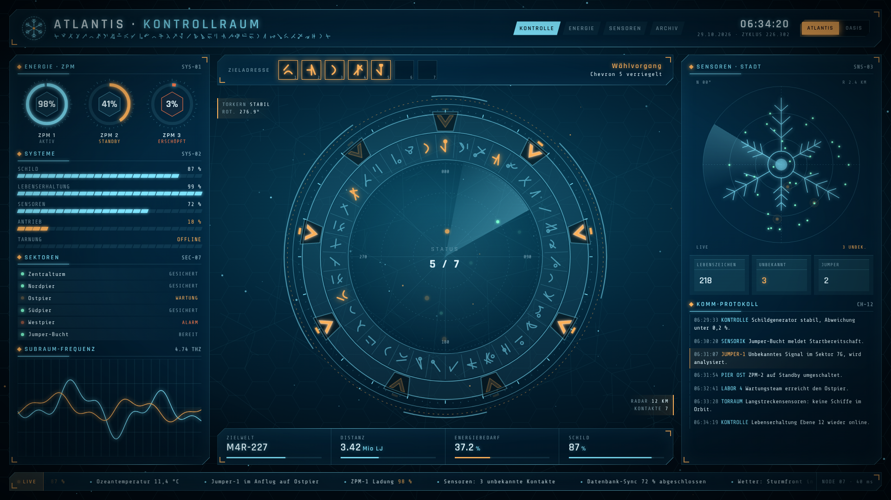
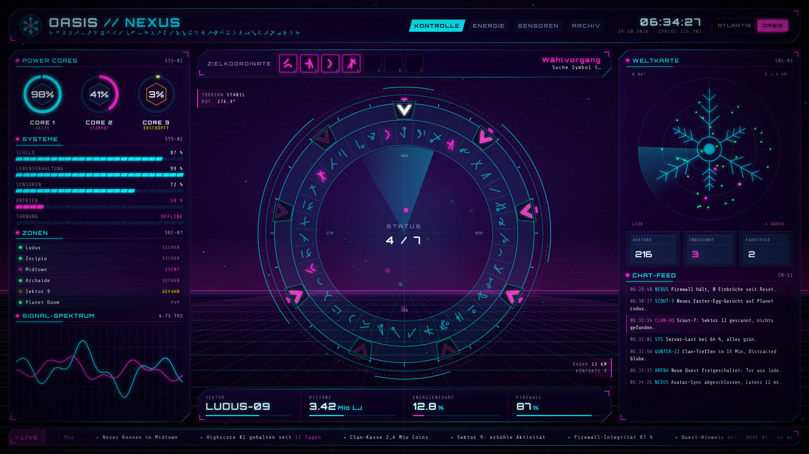
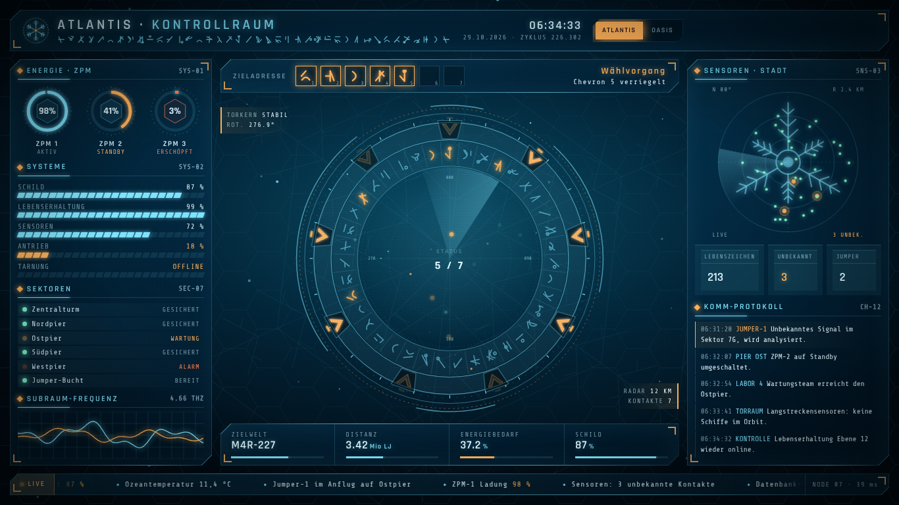
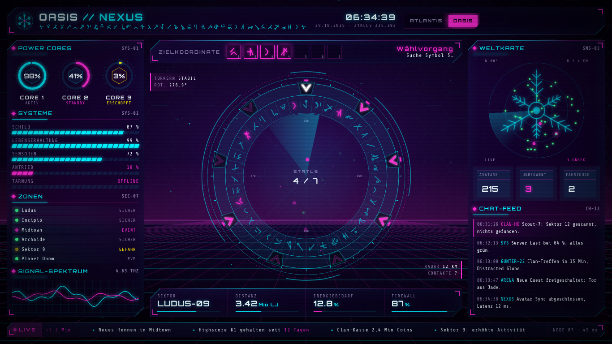
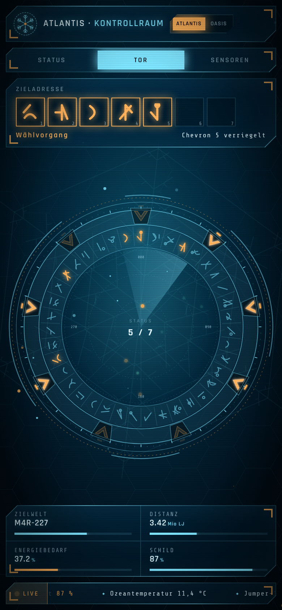
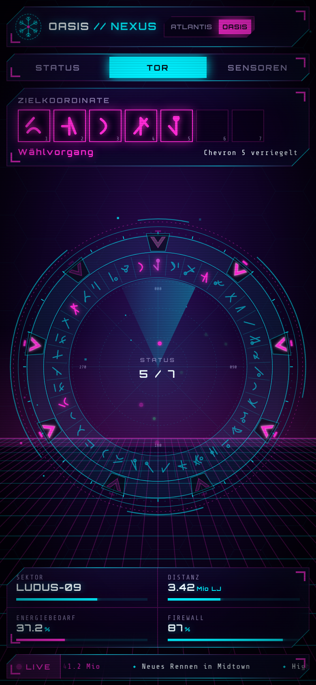

# Syfy UI

Ein Science-Fiction-Kontrollraum als einzelne HTML-Datei, inspiriert von **Stargate Atlantis** und **Ready Player One (OASIS)**. Ohne Framework, ohne Build-Schritt: nur HTML, CSS, SVG, Canvas und etwas JavaScript.

## Starten

`index.html` im Browser öffnen. Fertig.

- Theme-Schalter oben rechts, oder per URL: `index.html?theme=oasis` / `?theme=atlantis`
- `prefers-reduced-motion` wird respektiert (statisches, verbundenes Tor)

## Themes

| Atlantis | OASIS |
|---|---|
| Eisblau, Türkis, Bernstein; ruhig, gläsern, Schneeflocken-Geometrie | Neon Cyan und Magenta auf Schwarz; Retro-Horizontgitter, härtere Kanten |

## Layout

- `html, body` sind fest `100dvw × 100dvh` mit `overflow: hidden`: die Seite scrollt nie, nur Panels intern.
- Desktop/Laptop: Kopfleiste, linkes und rechtes Panel, Stargate-/Radar-Ring in der Mitte, Laufband unten.
- Handy (≤ 700 px): Seitenpanels werden zu Tabs.

## Screenshots

| | Atlantis | OASIS |
|---|---|---|
| 1366 × 768 |  |  |
| 390 × 844 |  |  |

Schriften: Orbitron, Rajdhani, Share Tech Mono (Google Fonts).
